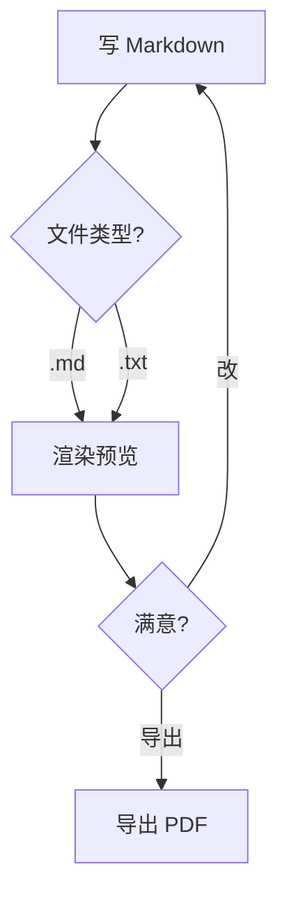
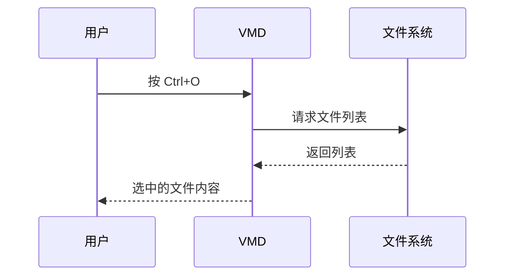

# VMD · 一个轻量的 Markdown 编辑器（带实时预览）

[](https://github.com/oyksoft/VMD)
[](https://github.com/oyksoft/VMD)
[](https://github.com/oyksoft/VMD)

> 用 Tauri + 系统自带 WebView 写的小工具，**打开就能用**，**全离线**，**不需要 Node / Python / Electron**。

左边写，右边实时看到效果。写的每一个字都是**纯 Markdown 源码**，所见即所得，不给你偷偷加格式。

---

## 这是个什么软件

**VMD 是一个 Windows 上的 Markdown 笔记 / 文档编辑器** —— 左边是纯 Markdown 源码，右边是实时渲染的预览。

它做的事就三件，但每件都做得很实在：

1. **写** —— 双栏对着写，所见即所得。你写的每一行都是标准 Markdown 源码，
   VMD 不会给你塞任何私有格式，文件拿别的编辑器打开一样能用。
2. **看** —— Mermaid 流程图、LaTeX 公式、代码高亮、表格、Emoji 短代码都支持，
   渲染结果就是最终排版，不是「预览个大概」。
3. **存** —— 就是一个普通的 `.md` 文件。双击能开、能关联、能拖进来、能导出 PDF。

**适合谁**：写技术文档 / 博客草稿 / README 的人，需要离线或在内网工作的人，
以及不想被 Typora / Obsidian 那种「格式锁死」绑架的人。

**不适合谁**：要协同 / 云同步的人（VMD 是纯本地工具），
要导出 Word / PPT 的人，或者想要 Word 那种所见即所得富文本的人。

**一句话**：如果你需要的是一个「安静、离线、打开就写」的 Markdown 编辑器，VMD 就是干这个的。

---

## 三种用法，切换着来

- ✏️ **编辑模式** —— 左源码右预览，边写边看（拖分隔条可以调比例）
- 👁️ **阅读模式** —— 只留预览，沉浸阅读
- 📑 **目录栏** —— 自动列出所有标题，点一下就跳过去

**写作时**：

- 写完按 `Ctrl+S` 直接存成 `.md`（`Ctrl+N` 新建 / `Ctrl+O` 打开 / `Ctrl+Shift+S` 另存为）
- 标题栏显示文件名，改动没保存时后面跟个 `●`
- 滚动时预览区**跟着编辑器一起滚**，长文档不用来回找位置
- 写错 `**加粗**`（中间多了空格）会**黄色高亮 + 悬停提示**，不改你的源码也能发现
- **把 `.md` 文件拖进窗口**就直接打开，不用先开文件对话框
- 字号看着小？`Ctrl` + `+` / `-` 调（80% ~ 150%），目录、编辑区、预览区一起变

**预览时**：

- 点目录跳转、回到顶部 / 跳到底部
- 右键菜单：复制 / 全选 / 格式化（加粗、斜体、代码）/ 插入链接、代码块、表格
- 点链接或图片，**在外部浏览器打开**，App 自己不跳走
- 代码块右上角有**语言标签**和**复制按钮**，点一下复制整段代码
- 表格是清爽的网格样式，只有一层淡淡的线
- 同一个文件被别的程序改了，VMD 会**提醒你**（可以弹窗问，也可以让它自动跟随更新）

**导出 PDF**：

- 工具栏「导出 PDF」按钮（或 `Ctrl+Shift+E`）
- 用的是**当前渲染引擎直接出图**，所以排版跟你看到的**一模一样**（流程图、公式、高亮全在）
- 自动只导**正文内容**（不含工具栏/目录/编辑区），A4 纵向，自动切浅色打印配色

---

## 它能渲染什么

| 内容 | 支持 | 示例 |
|---|---|---|
| 标准 Markdown（标题 / 列表 / 引用 / 表格 / 引用块） | ✅ | 标准语法 |
| **加粗** *斜体* ~~删除线~~ | ✅ | `**加粗**` `*斜体*` `~~删除线~~` |
| `行内代码` 和多行代码块 | ✅ | 自动语法高亮，右上角有语言标签 + 复制按钮 |
| 图片 + 链接 | ✅ | 点击图片 / 链接在**外部浏览器**打开，App 本身不跳转 |
| 表格 | ✅ | GitHub Flavored Markdown 风格 |
| 任务列表 | ✅ | `- [x] 已完成` `- [ ] 待办` |
| 流程图 / 序列图 / 类图 / 状态图 / 甘特图 / 饼图 | ✅ | 用 Mermaid，写法兼容老式和新式两种 |
| 数学公式 | ✅ | 行内 `$E=mc^2$` / 块级 `$$\int...$$`，支持 LaTeX |
| 代码块直接当公式渲染 | ✅ | `math` / `latex` 代码块当公式 |
| Emoji 短代码 | ✅ | `:smile:` `:rocket:` `:+1:`，1913 条（代码块和行内代码里不替换） |
| 内联目录 `[TOC]` / `[TOCM]` | ✅ | 自动生成当前位置的目录 |

---

## 它长什么样

**三栏布局** —— 目录 / 编辑区 / 预览区，**每一栏宽度都能拖动**，双击分隔条恢复默认。

- 📑 **左侧**：自动从 Markdown 标题生成目录，点一下跳转
- ✏️ **中间**：Markdown 源码编辑器
- 👀 **右侧**：实时渲染的预览

**八种配色**：
- 🖥️ 跟随系统
- 🌙 暗色
- 🌫️ 灰色
- ☀️ 浅色

外加四套柔和的有色主题（低饱和，长时间看比较耐看）：
- 🌾 暖阳（米黄）
- 🎋 青竹（淡绿）
- 🌊 雾蓝（淡蓝灰）
- 💜 暮紫（淡紫灰）

滚动条颜色也会跟着主题自动变，不用手动配。

---

## 实用功能

### 智能书写提示

写错 `**...**`（中间有空格不形成粗体）时，预览里会**黄色高亮 + 悬停提示**哪里写错了。不污染 Markdown 源码。

### 右键菜单

每个区域有自己的菜单项：

**编辑区**：撤销 / 重做 / 剪切 / 复制 / 粘贴 / 全选 / 加粗 / 斜体 / 代码 / 链接 / 代码块 / 表格

**阅读区**：复制 / 全选 / 回到顶部 / 跳到底部 / 打开链接

### 滚动同步

在编辑区滚轮上下滚，**预览区跟着滚**（反之亦然）。长文档不用手动找对应位置。

### 链接不在应用里跳转

点预览里的链接（包括图片包着链接的情况），**调用系统默认浏览器打开**——Edge / Chrome / Firefox 看你设置。Markdown 应用永远不会"卡在某个网页"。

### 文件操作

- `Ctrl+N` 新建 · `Ctrl+O` 打开 · `Ctrl+S` 保存 · `Ctrl+Shift+S` 另存为
- 支持 `.md` / `.markdown` / `.txt`
- 标题栏显示文件名，`●` 表示有未保存修改
- **把文件直接拖进窗口就能打开** —— 从资源管理器、VS Code、浏览器拖过来都行，
  拖动时窗口上会提示"松开鼠标打开文件"；类型不对会明确告诉你，只支持上面三种
- **按 `Tab` 缩进、`Shift+Tab` 反缩进** —— 写嵌套列表时不用去改缩进了（用 2 个空格，
  CommonMark 里 4 个空格会被当成代码块）

### 查找与替换

`Ctrl+F` 查找，`Ctrl+H` 查找并替换。查找栏就浮在当前这一侧的上方，
用 `查找` / `替换` 两个页签切换，**不用记快捷键也能切**。

- **编辑模式**查的是**源码**（左边），能替换：单条替换 / 全部替换，
  全部替换是一次操作，`Ctrl+Z` 一下就整体撤销
- **阅读模式**查的是**正文**（右边），只查不换 —— 正文没有"源码"可改，
  这时「替换」页签是灰的
- 所有匹配处都会高亮，当前那个更亮；`Enter` 下一个 / `Shift+Enter` 上一个，
  视图自动滚过去
- 找不到匹配时会明确说"没有找到匹配项"，不会误报替换了几处

### 编辑区状态

编辑区右下角实时显示**光标在第几行 / 总行数 / 字数**（空白不算字数），
移动光标就跟着变。

### 同时开多个窗口

可以同时开好几个 VMD（比如对照着看两份文档），**每个窗口互相独立**：
各自有自己的 WebView2 环境，键盘输入、查找、滚动都不会串台。

### 外部修改检测

文件被别的程序改了（用 Typora / VS Code 改同一份文档），VMD 会发现：

- **自动重载关着**（默认）→ 弹窗问你要不要重新加载；
  选「保留当前内容」的话，文件名旁边会亮起 `⚠ 外部已修改` 的标记，点它可以再问一次
- **自动重载开着**（工具栏 `⟳ 自动重载`）→ 直接自动更新内容，不用问。
  这时编辑器是**只读**的（避免自动刷新把你正在写的内容冲掉），关掉开关就能继续编辑

保存、另存为、重新加载之后，标记会自动清除。

### 文字缩放

工具栏的 `🔍` 按钮（或 `Ctrl` + `+` / `-` / `0`）可以调整**内容区**（左侧目录 / 编辑区 / 预览区）的文字大小，**80% ~ 150%**，设置会记住。

预览区里的标题、代码块、表格会跟着一起变大变小；工具栏保持原样，窗口不会被撑开。

### 设置

工具栏右上角的 `⚙` 打开设置面板（右上角显示版本号和项目 GitHub 地址）：

| 设置项 | 说明 |
|---|---|
| 默认主题 | 跟随系统 / 暗色 / 灰色 / 浅色（默认跟随系统） |
| 默认模式 | 打开文件时进阅读模式还是编辑模式（默认阅读） |
| 文件关联 | 一键把 `.md` / `.markdown` 的**默认打开方式**设为 VMD，或取消关联 |
| 系统右键菜单 | 在资源管理器里右键 `.md` 时，多一个「用 VMD 打开」项（或移除它） |
| 快捷键 | 一张速查表，不用记 |

设置会记在本地，下次启动自动生效。

文件关联和右键菜单项都写在**当前用户**的注册表里，不需要管理员权限，也不影响别的用户，两者互不影响。
如果双击 .md 没反应（Windows 可能记着别的程序）：右键 →「打开方式」→ 选 VMD → 勾选「始终使用此应用」。

---

## 实际渲染效果

下面这些不是截图，是 **README 本身**。GitHub 原生支持 mermaid 和公式，所以你在网页上看到的就是 VMD 里的效果。

### 流程图



### 序列图



### 数学公式

行内：质能方程 $E = mc^2$，欧拉恒等式 $e^{i\pi} + 1 = 0$。

块级（麦克斯韦方程组）：

$$
\nabla \cdot \mathbf{E} = \frac{\rho}{\varepsilon_0}
\qquad
\nabla \times \mathbf{B} = \mu_0 \mathbf{J} + \mu_0 \varepsilon_0 \frac{\partial \mathbf{E}}{\partial t}
$$

高斯积分：

$$
\int_{-\infty}^{\infty} e^{-x^2}\,dx = \sqrt{\pi}
$$

### 表格 / 任务列表 / 引用

| 功能 | 状态 | 备注 |
|---|:---:|---|
| 表格 | ✅ | 自动对齐、边框自适应主题 |
| 任务列表 | ✅ | `- [x]` / `- [ ]` |
| 引用块 | ✅ | 可嵌套 |

- [x] 打开文件
- [x] 实时预览
- [x] 导出 PDF
- [ ] 云同步（还没做）

> 引用块也支持嵌套。
>
> > 像这样。

### 代码高亮

代码块右上角会显示**语言名**（源码里 ``` 后面写的那种，没写就不显示），旁边有个**复制按钮**，点一下复制整段代码。

```python
def fibonacci(n: int) -> int:
    """斐波那契数列"""
    a, b = 0, 1
    for _ in range(n):
        a, b = b, a + b
    return a
```

### 目录占位符

在 VMD 里写 `[TOC]` 或 `[TOCM]`，会在当前位置插入自动生成的目录（GitHub 不支持这个语法，所以这里只能看源码）：

```markdown
# 标题

[TOC]      ← 层级缩进目录
[TOCM]     ← 扁平列表目录
```


---

## 离线 / 本地化

- **所有依赖打包到本地**（`vendor/` 目录，约 3.3MB）—— KaTeX 数学公式字体、Mermaid 流程图库、highlight.js 代码高亮、Markdown 解析器
- **不联网**（首次启动后无任何网络请求）
- **不收集数据**
- **单文件 3.7MB** —— 所有前端资源经 brotli 压缩后嵌进 exe，绿色版解压即用，不写注册表

---

## 适合谁用

- 写技术文档 / 博客草稿 / README 的人
- 需要**离线**或在内网工作的环境
- 不想装 Electron + VSCode + 各种插件的"重型方案"
- 喜欢 Markdown 但不想被 Typora / Obsidian 等"格式锁死"绑架的人（VMD 写的就是纯 Markdown 源文件，所见即所得，不擅自改你的格式）
- 需要**既读又写**的人（内置编辑器 + 实时预览，拖动分隔条可以左右分屏对照）
- 在 Windows 上

---

## 不适合谁用

- ❌ macOS / Linux 用户（当前 Windows 专属，依赖 WebView2；移植需要小改但还没做）
- ❌ 需要协同 / 云同步的人（VMD 是纯本地工具）
- ❌ 需要导出 Word / PPT / EPUB 的人（当前支持导出 PDF 和 HTML）
- ❌ 需要"所见即所得"的富文本编辑器的人（VMD 写的是纯 Markdown 源码，不是 Word 那种所见即所得）

---

## 运行 / 开发

```bash
cd src-tauri
cargo run          # 调试（带 CMD 窗口，方便看日志）
cargo build --release   # 发布（约 1 分钟，产物在 target/release/vmd.exe）
```

前端纯 HTML / CSS / JS，**无构建步骤**（没有 npm、没有打包器）。

> 但注意：前端资源是**编译进 exe** 的（`tauri.conf.json` 里没有 devUrl），
> 所以改完 `src/` 里的文件**必须重新 `cargo build`** 才能看到效果，刷新浏览器没用。
> 调试用 `cargo run` 就行（debug 增量编译几秒）。

### 打包绿色版

```powershell
cd src-tauri
# ⚠️ 换过图标后必须 touch tauri.conf.json，否则图标不会重新嵌入
(Get-Item tauri.conf.json).LastWriteTime = Get-Date
cargo build --release
mkdir ..\release -Force | Out-Null
copy /y target\release\vmd.exe ..\release\VMD.exe
cd ..\release
Compress-Archive -Path VMD.exe,README.txt -DestinationPath VMD-0.2.8-win64-portable.zip -Force
```

> touch `tauri.conf.json` 这步别漏 —— `tauri-build` 只监听配置文件的变化，
> 改了 `icons/icon.ico` 不 touch 的话，exe 里还是旧图标。

---

## 更新日志

### 0.2.8

**中文输入法卡死的根治** —— 编辑区从 `<textarea>` 换成了 `contenteditable`。

- 🐛 **大文档里输入中文，一个汉字卡几十秒** —— 根因在 Blink 本身：
  `<textarea>` 在**输入法组字**时走 `SetInnerEditorValue`（**整体替换整个 value**），
  每次按键都要把**所有行**重新排版一遍。成本严格 ∝ 行数：

  | 内容规模 | 整体替换 + 重排（中文组字） | 增量插入 + 重排（英文打字） |
  |---|---|---|
  | 1 行 | 9ms | — |
  | 2000 行 | 16ms | — |
  | **3 万行** | **244~408ms** | 24~55ms |

  一个中文词要 4~8 个拼音键 → 1~3 秒；打一整句话就是几十秒。
  英文走增量插入，所以**完全不受影响** —— 这就是"只有中文卡"的原因。

  换成 `contenteditable`（每行一个块）后，Blink 能**增量布局** —— 组字只重排改动的那一行：
  **实测 3 万行文档里每键 14~17ms**。

  ⚠️ 这是浏览器层面的设计，不是 App 的 bug —— 所有用 `<textarea>` 做编辑器的都有这问题。

- 🐛 **选中的文字点完加粗就"不选中了"** —— 没法再点一次取消加粗。
  （`<textarea>` 的 `setSelectionRange(a,b)` 天然有范围；
  `contenteditable` 得自己构造 Range，而两个**折叠**的 Range 拼不出范围。）
- 🐛 **目录高亮不跟随** —— 预览区滚动时高亮卡在原处；点目录项后高亮也不落到被点的那项。
- 🐛 **浮动工具栏不显示 / 位置跑到别处** —— 三个独立原因：
  选区变化事件（`selectionchange`）、焦点判断、空行高度。
- 🐛 **CRLF 行尾的文件，所有字符偏移都错位** —— 模型里留着 `\r`，DOM 里没有。
- 🐛 **编辑区遇到 HTML 标签就中断** —— 打开含 `<textarea>` 这类标签的文档（比如本文件的更新日志），
  编辑区从那一行开始后面的内容全被吞进去，整个编辑区错乱。
  原因是文件里有两个同名 `escapeHtml` 函数，生效的是那个**没做转义**的空操作版本 →
  含标签的行被浏览器当成真标签解析（`<textarea>` 是原始文本元素，后面全被吞）。
- 🐛 **滚动预览区不再带动编辑区** —— 回弹抑制把用户自己的滚动误判成"程序同步的回弹"吞掉了。
- 🗑 **砍掉「光标跟随」设置项** —— 它和「滚动同步」功能重复，而且你手动把预览区滚到别处看内容时，
  打个字预览区就会被拽回光标处（乱跳）。而且这个功能从头到尾就没真正工作过
  （渲染时位置表是脏的 → 直接返回；注释说"下一帧会自动跟上"，但下一帧压根没再调它）。
  保留「滚动同步」—— 那才是有用的那个。
- 🐛 **阅读模式切回编辑模式后，滚预览区编辑区不跟随** —— 编辑区的可滚动高度缓存是 0，
  滚动同步里 `maxLine` 算成 -1，预览区一滚就直接返回。
  缓存只在 input 事件后刷新，而打开文件走的是 `setEditorText()`（不触发 input）；
  切换模式后要用 `setTimeout`（不是 rAF）刷新 —— rAF 回调在渲染前执行，布局还没重算。

**弹窗重新设计** —— 关闭询问的「不保存 / 取消 / 保存」三个按钮原来大小、字重完全不一致，
并排看着歪歪扭扭。现在**统一尺寸**，靠语义分层：主操作实心主题色、次操作描边、
「不保存」无框文字（危险时变红）。弹窗本体圆角加大、阴影加层、顶部一道渐变高光条、
出现时轻微浮起。

### 0.2.7

这一版把「写起来更顺手」做了一大截，另外重写了滚动同步 —— 之前两边总是对不齐。

#### ✍️ 写起来更顺手

- **选中文字就浮现工具栏** —— 在编辑区选中文字，上方出现一排按钮：
  **B**（加粗）、*I*（斜体）、`<>`（行内代码）、`{ }`（代码块）、🔗（链接）、~~S~~（删除线）。
  按一下加上，**再按一下取消**；当前是什么格式，按钮会点亮。
  代码块里选文字**不会**弹（里面是源码，套 Markdown 格式没意义）
- **快捷键** —— `Ctrl+B` / `Ctrl+I` / `Ctrl+\`` 加粗 / 斜体 / 行内代码，
  `Ctrl+1`~`Ctrl+6` 标题级别，`Ctrl+Shift+7/8` 有序 / 无序列表（再按一次取消），
  `Ctrl+Shift+X` 删除线
- **右键菜单按语义分两层** —— 「插入 ▸」二级菜单里放链接 / 图片 / 代码块 / 表格；
  格式化交给浮动工具栏，两边不再重复
- **插入图片** —— 右键「插入 ▸ 图片」，选个本地图片就行，
  自动写成**相对于当前文档的路径**（换台电脑还能用），光标直接落在图片说明里
- **代码自动换行**（设置项）—— 预览区里很长的代码行自动折行，
  表格单元格里的长代码也会断（不然整张表会被撑得比窗口还宽）。
  编辑区不受影响 —— 那边不折行是目录精确跳转的前提
- **删除线也会提示写法问题** —— `~~ 文字 ~~` 中间有空格不生效，
  现在会黄色高亮 + 悬停说明（跟粗体 / 斜体一样）

#### 🔄 滚动同步重写

之前两边总对不齐，根因是**按比例映射** —— 源码一行 ≠ 预览一行
（长段落会折行、表格的 `---` 分隔行不渲染、代码块行高不同），比例算出来必然偏。

现在改成**行级锚点表**：记录「预览里的哪个元素 ↔ 源码的哪一行」，
双向都查这张表，不再有任何"按比例估算"。
长段落按**字符比例**定位（渲染后的高度与内容量成正比）。

实测（README.md / AGENTS.md）：两边锚定的源码行号**平均差 0.2~1.5 行**。

- 🐛 **往下滚动滚动不了** —— 编辑区到底后 scrollTop 不再变，浏览器就不再触发 scroll 事件，
  收不到信号；而且预览滚到编辑区够不到的地方时会被拽回去。
  现在编辑区到底后，**滚轮会继续推动预览区**（预览渲染后必然更高）

#### 🐛 修的 Bug

- 🐛 **右键菜单插入 / 格式化后按不了 Ctrl+Z 撤销** —— 菜单里是直接改编辑区内容，
  把浏览器的撤销历史冲掉了。现在插入完能正常撤销
- 🐛 **点「新建」后预览和目录还留着上一个文件的内容** —— 增量渲染算「哪些块变了」的
  逻辑在文档变短 / 变空时算错，把「内容没变」误判成没变，预览就不刷新了
- 🐛 **打开新文件会停在上一个文件的那一行** —— 改内容不会重置滚动位置，现在换文件回到顶部
- 🐛 **只读模式下按快捷键会改到正文** —— 自动重载开着时内容应该是只读的
- 🐛 **在设置面板里按 Ctrl+1 会改到正文** —— 快捷键现在要求焦点在编辑区
- 🐛 **查找栏开着时打字报错**（`renderFindHighlights is not defined`）
- 🐛 **LaTeX 代码块不渲染** —— 识别 ```latex 围栏的正则里 ``（单词边界）
  之前是「实际的退格符」，永远匹配不上
- 🐛 **二级菜单会跑出屏幕** —— 现在靠屏幕右边时往左展开、下方空间不够时往上展开
- 🐛 **大文件里输入会卡死** —— 打开大文件、滚到靠后位置、再在编辑区输入，VMD 会卡住。
  原因是预览 DOM 刚改完时**布局是脏的**，这时候读任何会触发布局的东西
  （`getBoundingClientRect` / `scrollTop`），浏览器就得把整个预览
  （1MB 文档 = 1.2 万个元素）重新布局一遍，几百毫秒。
  现在目录渲染、锚点表、位置测量全部挪到下一帧（浏览器那一帧本来就要重排，顺带做不额外花钱）。
  实测 1MB 文档连续输入：**411~509ms → 117~175ms**

#### ⚙️ 其它

- 💎 编辑区右下角的行 / 字数改成**玻璃质感小标签**（平时不显示，鼠标移到编辑区底部才淡入）
- 💎 滚动同步加了设置开关（默认开）—— 万一还是不满意可以直接关掉
- 🔒 预览内容消毒：原始 HTML 里的 `<script>`、``、`javascript:` 链接都被清掉，
  但图片、表格、任务列表的勾选框这些正常功能一个不少
- 💾 保存改成「写临时文件 → 落盘 → 改名」，中途断电 / 被杀毒软件锁住，原文件完好
- 📝 GBK 编码的文件不会被偷偷转成 UTF-8，保存时按原编码写回
- 🆘 没保存的内容会定时存快照，万一崩了下次启动能恢复

### 0.2.6

0.2.5 的补丁版，修三个 Bug：

- 🐛 **「插入 > 图片」报错**（`insertAtCursor is not defined`）—— 插入图片用到的函数
  定义在右键菜单那个闭包内部，全局看不到。现在挪到全局了
- 🐛 **插入的图片渲染不出来** —— 没有当前文件时插入的是绝对路径（`D:/x.png`），
  但白名单不认盘符路径，图片地址被直接删掉。现在放行盘符路径了
- 🐛 **链接能执行本地程序** —— 别人给的 md 里放一个 `[点我](./xxx.exe)`，
  你一點它就被系统执行了。现在只有网址（http/https/mailto/tel）会自动打开，
  其余的提示一下就不动

### 0.2.5

这一版专注**写起来更顺手** —— 选中文字就有工具栏、常用操作有快捷键、
右键菜单按语义分成两层，另外修了几个影响体验的 Bug。

#### ✍️ 写起来更顺手

- **选中文字就浮现工具栏** —— 在编辑区选中文字，上方出现一排按钮：
  **B**（加粗）、*I*（斜体）、`<>`（行内代码）、`{ }`（代码块）、🔗（链接）、~~S~~（删除线）。
  按一下加上，**再按一下取消**；当前是什么格式，按钮会点亮。
  代码块里选文字**不会**弹（里面是源码，套 Markdown 格式没意义）
- **快捷键** —— `Ctrl+B` / `Ctrl+I` / `Ctrl+\`` 加粗 / 斜体 / 行内代码，
  `Ctrl+1`~`Ctrl+6` 标题级别，`Ctrl+Shift+7/8` 有序 / 无序列表（再按一次取消），
  `Ctrl+Shift+X` 删除线。
  改完标题 / 列表后**光标停在原来那个字后面**，不会突然把整行选中
- **右键菜单按语义分两层** —— 「插入 ▸」二级菜单里放链接 / 图片 / 代码块 / 表格；
  格式化交给浮动工具栏，两边不再重复
- **插入图片** —— 右键「插入 ▸ 图片」，选个本地图片就行，
  自动写成**相对于当前文档的路径**（换台电脑还能用），光标直接落在图片说明里
- **删除线也会提示写法问题** —— `~~ 文字 ~~` 中间有空格不生效，
  现在会黄色高亮 + 悬停说明（跟粗体 / 斜体一样）

#### 🐛 修的 Bug

- 🐛 **点「新建」后预览和目录还留着上一个文件的内容** —— 增量渲染算「哪些块变了」的
  逻辑在文档变短 / 变空时算错，把「内容没变」误判成没变，预览就不刷新了。
  同样的问题：**打开一个比当前文档短、开头几段相同的文件，预览也不更新**
- 🐛 **右键菜单插入 / 格式化后按不了 Ctrl+Z 撤销** —— 菜单里是直接改编辑区内容，
  把浏览器的撤销历史冲掉了。现在插入完能正常撤销
- 🐛 **只读模式下按快捷键会改到正文** —— 自动重载开着时内容应该是只读的。
  顺带修了查找替换在只读时会**误报「已替换 N 处」**
- 🐛 **在设置面板里按 Ctrl+1 会改到正文** —— 快捷键现在要求焦点在编辑区
- 🐛 **标题快捷键只到 3 级** —— 现在 `Ctrl+1`~`Ctrl+6` 六级都支持

#### 💬 其它

- 🔤 **代码自动换行**（设置项）—— 预览区里很长的代码行自动折行，
  表格单元格里的长代码也会断（不然整张表会被撑得比窗口还宽）。
  编辑区不受影响 —— 那边不折行是目录精确跳转的前提
- 🔒 **预览内容消毒** —— 打开别人给的 `.md` 不会再有风险。
  原始 HTML 里的 `<script>`、``、`javascript:` 链接都被清掉了，
  但图片、表格、任务列表的勾选框这些正常功能一个不少
- 🖼 **预览里的本地图片能显示了** —— `` 之前一律空白
  （程序不让网页直接读本地文件），现在正常显示，导出的 HTML 也是自包含的
- 🆘 **崩溃恢复** —— 没保存的内容会定时存一份快照（每 5 秒），
  万一程序崩了 / 被强杀了，下次启动会问你要不要恢复
- 💾 **保存不会半路截断文件** —— 改成「写临时文件 → 落盘 → 改名」，
  中途断电 / 被杀毒软件锁住，原文件完好
- 📝 **GBK 编码的文件不会被偷偷转成 UTF-8** —— 现在能认出来，保存时按原编码写回
- ⚡ **长文档渲染改增量** —— 1MB 的文档改一个字，从 1.2 秒降到 **150 毫秒**
- 📑 **目录不再跟着每次输入重建**
- 🔬 Mermaid 收紧到 strict 模式 —— 别人给的文档里的流程图不能再偷偷挂链接
- 🔍 文字缩放改成 5% 一档 —— 原来 10% 一档，中间值够不着
- 💬 界面文案去掉技术黑话

### 0.2.4

这一版基本都是「把地基打牢」—— 安全、可靠、长文档能用，另外加了两个新功能。

**新增**

- 🆘 **崩溃恢复** —— 没保存的内容会定时存一份快照（每 5 秒），
  万一程序崩了 / 被强杀了，下次启动会问你要不要恢复。
  拖 `.md` 进来时如果会覆盖正在写的内容，现在也会先问一句了
- 🔤 **代码自动换行**（设置项）—— 预览区里很长的代码行自动折行，不用横向拖。
  表格单元格里的长代码也会断（不然整张表会被撑得比窗口还宽）。
  编辑区不受影响 —— 那边不折行是目录精确跳转的前提
- 🔒 **预览内容消毒** —— 打开别人给的 `.md` 不会再有风险。
  原始 HTML 里的 `<script>`、``、`javascript:` 链接都被清掉了，
  但图片、表格、任务列表的勾选框这些正常功能一个不少

**修复**

- 🐛 **预览里的本地图片加载不出来** —— `` 这种相对路径的图片
  之前一律空白（WebView2 不让网页直接读本地文件）。现在由程序读出来内嵌成图片，正常显示
- 🐛 **拖进来的文件会静默覆盖正在写的内容** —— 之前完全没提示，改一下就没了。现在会先问
- 🐛 **保存时会半路截断文件** —— 之前是「清空再写」，写到一半断电 / 被杀毒软件锁住，
  文件就废了。现在改成「写临时文件 → 落盘 → 改名」，中途出事原文件完好
- 🐛 **GBK 编码的文件被悄悄转成 UTF-8** —— 现在能认出来（UTF-8 / 带 BOM 的 / UTF-16 / GBK），
  保存时按原来的编码写回去，不会偷偷改你文件的格式
- 🐛 **浏览器原生 `alert` 弹窗** —— 全部换成应用内弹窗，样式跟主题一致
- 🐛 **Mermaid 渲染失败时的提示块会执行源码里的 HTML** —— 现在改成纯文本显示

**优化**

- ⚡ **长文档渲染改增量** —— 以前每次敲一个字，整篇文档都要重新解析 + 重新排版。
  1MB 的文档改一个字要等 1.2 秒；现在只重算真正变了的那几块，**约 150 毫秒**（快 8 倍）
- 📑 **目录不再跟着每次输入重建** —— 以前每敲一个字目录都在抖。现在结构没变就原地更新
- 🔬 **Mermaid 收紧到 strict 模式** —— 别人给的文档里的流程图不能再偷偷挂链接
- 🔍 **文字缩放改成 5% 一档** —— 原来 10% 一档，中间值够不着
- 💬 界面文案去掉技术黑话

### 0.2.3

**新增**

- 🔍 **查找与替换** —— `Ctrl+F` 查找、`Ctrl+H` 查找并替换，查找栏浮在当前这一侧的上方，
  用「查找 / 替换」页签切换（不用记快捷键也能切）。
  **编辑模式查源码（能替换），阅读模式查正文（只查不换，「替换」页签置灰）**。
  所有匹配处高亮、当前那个更亮，`Enter` 跳下一个，视图自动跟随
- 📊 **编辑区右下角状态** —— 光标在第几行 / 总行数 / 字数（空白不算字数），跟着光标实时更新
- ⌨️ **编辑区按 `Tab` 缩进、`Shift+Tab` 反缩进** —— 以前按 Tab 焦点会跳到工具栏按钮上，
  写嵌套列表得手动改缩进
- 🪟 **可以同时开多个窗口** —— 每个窗口完全独立，键盘输入、查找、滚动都不串台
- 📋 **设置面板加了快捷键速查表**

**修复**

- 🐛 **同时开两个窗口时，后开的那个打不了字** —— 原因是两个进程共用了同一个 WebView2
  用户数据目录，WebView2 会把第二个窗口挂到第一个的浏览器进程上，键盘输入全被抢走。
  现在每个实例用独立的环境
- 🐛 **目录跟随滚动高亮从来没生效过** —— 监听挂在了不滚动的元素上，滚动时目录不会标出当前章节
- 🐛 **`F5` / `Ctrl+R` 刷新会把没保存的内容全丢** —— 而且不问你。现在彻底拦掉了（三层防护）
- 🐛 **`Ctrl+H` 在编辑区没用** —— 它是浏览器保留键，页面根本收不到这个按键
- 🐛 **阅读模式查找时计数一直是 `0/0`** —— 一处循环变量写成了只读，异常被静默吞掉
- 🐛 **预览区的查找框会跟着正文滚走** —— 滚到后面就看不见了
- 🐛 **搜不到结果时点「全部替换」会误报"已替换 1 处"** —— 还会白白污染一次撤销栈
- 🐛 **自动重载在没有可盯的磁盘版本时也能开** —— 新建的文件、还有未保存修改时，
  自动刷新根本就是伪命题。现在这种情况下按钮直接置灰，并说明原因
- 🐛 **文件被外部删掉后自动重载还开着** —— 编辑器会一直卡在只读，动不了
- 🐛 **新建文件时不会切到编辑模式** —— 阅读模式下新建，得自己再点一下切换
- 🐛 只读模式（自动重载）下「保存 / 另存为」按钮没置灰，点了才弹提示

**优化**

- 💬 **界面文案去掉技术黑话** —— 比如"还没落盘"改成"还没保存"
- 💬 关闭时如果文件已被删除，"文件已被删除"的提示只弹一次（之前每 3 秒弹一次）
- 💬 找不到匹配项时明确说"没有找到匹配项"，不再默默什么都不做

### 0.2.2

**修复**

- 💾 **关闭窗口前会问「要保存修改吗？」** —— 之前点 X 直接退出，编辑区里没保存的内容全丢。现在弹「保存 / 不保存 / 取消」三选一，保存成功才关窗；保存失败（取消了"另存为"）窗口会留着
- 📂 **打开另一个文件前也会问** —— 之前完全没有检查，打开新文件会静默覆盖当前编辑的内容
- 📝 **新建文件前也会问** —— 原来用的是浏览器原生 `confirm()`，样式跟整体 UI 不搭，现在换成应用内弹窗
- 🪟 **两个弹窗叠在一起不再卡死** —— 之前同时弹出两个对话框（比如「文件被外部修改」还开着又点了 X）会互相顶掉，前一个弹窗永远不消失，连带外部修改检测和关窗询问都失效、点 X 没反应。现在改成排队，一个接一个弹

**优化**

- ✨ **弹窗样式重做** —— 玻璃质感面板（背后内容能透出来）、标题带单色图标、文件名加粗突出
- 🎨 **按钮分了三层** —— 「保存」是主题色主按钮，「不保存」是红色描边（丢数据的操作一眼看出不同），「取消」是普通按钮

### 0.2.1

**新增**

- 🌐 **导出 HTML** —— 工具栏「导出 ▾ → 导出 HTML」，输出一个**自包含的单文件**：图片转成 base64 内嵌、公式用的字体一起打包，双击就能在浏览器打开，也能直接发给别人
- 🎨 **主题悬停即时预览** —— 在设置面板的主题色块上悬停，整个窗口立刻换成那个主题；移开恢复当前生效的主题
- 🧭 **工具栏重新分组** —— 文件操作靠左、文件名居中当标题、视图控制（自动重载 / 缩放 / 阅读编辑 / 主题 / 设置）靠右
- 😀 **Emoji 短代码** —— 输入 `:smile:` 自动变成 😄，1913 条（GitHub 同款数据集）。源码里保持原样，只在预览里替换；代码块和行内代码里的不动
- 🧮 **欢迎页补上数学公式示范** —— 行内 / 块级 LaTeX 各一个，进来就能看到效果

**优化**

- 📏 **文件名太长不再撑宽工具栏** —— 超长文件名中间省略（`很长的文件…名称.md`），鼠标悬停显示完整路径
- 🔘 **主题按钮改成图标** —— 只留一个图标 + 下拉箭头，点开选主题，完整名称放 tooltip，省下约 70px 宽度
- 💬 **临时提示改成浮层** —— 「已保存 / 已导出 / 自动重载已关闭」这类提示浮在窗口上方居中，不再占工具栏的位置，也不怕长提示把按钮顶走
- 📋 **设置面板的说明改成标题旁的小字** —— 「默认项下次启动生效」写在「设置」标题后面，并且说准了适用范围（只有默认主题 / 默认模式是下次生效，文件关联和右键菜单是立即生效）
- 🐛 开启「自动重载」后编辑区是只读的，但右键菜单的「加粗 / 斜体 / 粘贴 / 撤销」居然还能改内容 —— 现在这些项正确置灰
- 🐛 弹窗文案说「这些修改会被丢弃」，实际内容并不会丢（只是不能再编辑）—— 已改成说真实后果

### 0.2.0

**新增**

- 📥 **把文件拖进窗口直接打开** —— 从资源管理器、VS Code、浏览器拖过来都行；只接受 `.md` / `.markdown` / `.txt`，类型不对会明确告诉你
- ⚙️ **设置面板**（工具栏 `⚙`）—— 默认主题、默认模式、文件关联、软件内右键菜单都能配；右上角显示版本号和项目地址
  - 设置项只保存、**下次启动生效**，不会打断当前正在编辑的内容（想现在就换，用工具栏的主题按钮和「阅读/编辑」按钮）
- 🎨 **四款新主题** —— 🌾 暖阳 / 🎋 青竹 / 🌊 雾蓝 / 💜 暮紫，低饱和的柔和色，长时间看不刺眼
- 🔗 **文件关联** —— 一键把 `.md` / `.markdown` 设成用 VMD 打开（只写当前用户，不需要管理员权限）
- 📋 **右键菜单项** —— 资源管理器里右键 `.md` 多一个「用 VMD 打开」
- 🔍 **文字缩放** —— 工具栏 `🔍` 或 `Ctrl` + `+` / `-` / `0`，80% ~ 150%，目录 / 编辑区 / 预览区一起缩放
- 🔔 **外部修改检测** —— 文件被别的程序改了会弹窗问你要不要重新加载；也可以开「自动重载」直接跟随更新（此时编辑器转只读，不打断你写字）
  - 选「保留当前内容」的话，文件名旁边会亮起 `⚠ 外部已修改` 的标记，点它可以再问一次
- 📄 **窗口标题带文件名** —— `README.md - VMD`，多开窗口时一眼分得清

**优化**

- ✨ **启动不再闪白/闪黑** —— 窗口底色和页面首帧用同一份设置，启动就是最终颜色
- 🖱️ **目录跳转精确对齐** —— 点目录时编辑区直接落到对应那一行，不再是按比例估算
- 🎨 **滚动条跟随主题** —— 滑块颜色从主题色自动派生，不用每套主题手写
- 🐛 切到阅读/编辑时目录栏宽度乱跳
- 🐛 停用软件内右键菜单后，原生菜单也不出来（前后端开关没同步）

### 0.1.1

**新增**

- 📄 **导出 PDF** —— 工具栏按钮 / `Ctrl+Shift+E`，用当前渲染引擎直接出图，流程图、公式、代码高亮全部保留
  - 自动只导正文（不含工具栏/目录/编辑区），A4 纵向
  - 自动切换浅色打印配色，深色背景不再浪费墨
- 📋 **代码块复制按钮** —— 右上角一键复制，点击后图标变成对勾
- 🏷️ **代码块语言标签** —— 源码里 ` ```python ` 指定的语言会显示在右上角（没指定就不显示）
- 🎨 **新应用图标** —— Markdown 官方标志 M↓，7 种尺寸（16→256）适配高分屏
- 🖼️ **表格样式重做** —— 网格线只画一层，不再是叠成双线的"厚边框"
- 🖌️ **等宽字体优化** —— Cascadia Mono / Consolas + 中文用无衬线（不再掉到宋体）
- 📦 **体积从 5.5MB 降到 3.7MB** —— 移除用不上的插件、精简依赖、精简编译参数

**修复**

- 🐛 "跟随系统"主题现在**真的**跟随系统（之前被 Tauri 强制成浅色）
- 🐛 主题按钮默认显示"跟随系统"，tooltip 提示当前实际生效的
- 🐛 导出 PDF 只有第一页有内容（html/body 的 `overflow:hidden` 裁掉了）
- 🐛 Mermaid 图表在暗色/灰色主题下线条看不清（现在跟随主题配色）
- 🐛 `**加粗**` 误报黄色警告（判断条件写反了）
- 🐛 代码块/行内代码里的 `[TOC]` 会被误替换成真目录
- 🐛 多个 `[TOC]` 只有第一个被替换
- 🐛 点目录跳转时工具栏消失
- 🐛 右键菜单点一下就消失 / 关不掉
- 🐛 预览区链接会把整个 App 跳走（现在交给系统浏览器）

### 0.1.0

- 初版：三栏布局、双模式切换、四套主题、代码高亮、文件操作、快捷键

---

## 项目结构

```
VMD/
├── src/                    ← 前端（纯 HTML/CSS/JS，无构建步骤）
│   ├── index.html
│   ├── style.css
│   ├── theme.js            ← 主题调色板 + 首帧前应用主题
│   ├── app.js
│   └── vendor/             ← 本地依赖，不联网
│       ├── marked.min.js           Markdown 解析
│       ├── highlight.min.js        代码高亮
│       ├── highlight-*.css         高亮配色（暗/灰/浅）
│       ├── katex/                  数学公式（含字体）
│       └── mermaid.min.js          流程图 / 序列图
├── src-tauri/              ← Rust 后端（Tauri 2）
│   ├── Cargo.toml
│   ├── tauri.conf.json
│   ├── capabilities/       权限白名单
│   ├── icons/              应用图标（含 icon.svg 源文件）
│   └── src/
│       ├── main.rs         ← 命令、窗口、WebView2 互操作
│       ├── drop.rs         ← 文件拖放（自己实现的 IDropTarget）
│       └── assoc.rs        ← 文件关联 / 右键菜单项（写 HKCU 注册表）
├── AGENTS.md               ← 给 AI 协作者的仓库说明
└── release/                ← 绿色版产物（VMD.exe + zip）
```

---

## 许可

MIT（暂定 — 可改）