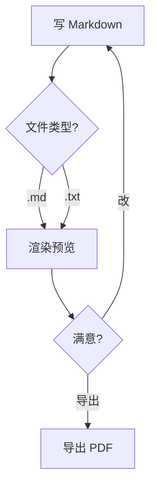
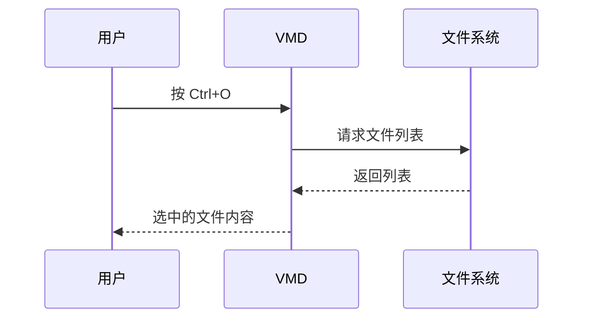

# VMD · 一个轻量的 Markdown 编辑器（带实时预览）

[](https://github.com/oyksoft/VMD)
[](https://github.com/oyksoft/VMD)
[](https://github.com/oyksoft/VMD)

> 用 Tauri + 系统自带 WebView 写的小工具，**打开就能用**，**全离线**，**不需要 Node / Python / Electron**。

左边写，右边实时看到效果。写的每一个字都是**纯 Markdown 源码**，所见即所得，不给你偷偷加格式。

---

## 三种用法，切换着来

- ✏️ **编辑模式** —— 左源码右预览，边写边看（拖分隔条可以调比例）
- 👁️ **阅读模式** —— 只留预览，沉浸阅读
- 📑 **目录栏** —— 自动列出所有标题，点一下就跳过去

**写作时**：

- 写完按 `Ctrl+S` 直接存成 `.md`（`Ctrl+N` 新建 / `Ctrl+O` 打开 / `Ctrl+Shift+S` 另存为）
- 标题栏显示文件名，改动没保存时后面跟个 `●`
- 滚动时预览区**跟着编辑器一起滚**，长文档不用来回找位置
- 写错 `**加粗**`（中间多了空格）会**黄色高亮 + 悬停提示**，不改你的源码也能发现
- **把 `.md` 文件拖进窗口**就直接打开，不用先开文件对话框
- 字号看着小？`Ctrl` + `+` / `-` 调（80% ~ 150%），目录、编辑区、预览区一起变

**预览时**：

- 点目录跳转、回到顶部 / 跳到底部
- 右键菜单：复制 / 全选 / 格式化（加粗、斜体、代码）/ 插入链接、代码块、表格
- 点链接或图片，**在外部浏览器打开**，App 自己不跳走
- 代码块右上角有**语言标签**和**复制按钮**，点一下复制整段代码
- 表格是清爽的网格样式，只有一层淡淡的线
- 同一个文件被别的程序改了，VMD 会**提醒你**（可以弹窗问，也可以让它自动跟随更新）

**导出 PDF**：

- 工具栏「导出 PDF」按钮（或 `Ctrl+Shift+E`）
- 用的是**当前渲染引擎直接出图**，所以排版跟你看到的**一模一样**（流程图、公式、高亮全在）
- 自动只导**正文内容**（不含工具栏/目录/编辑区），A4 纵向，自动切浅色打印配色

---

## 它能渲染什么

| 内容 | 支持 | 示例 |
|---|---|---|
| 标准 Markdown（标题 / 列表 / 引用 / 表格 / 引用块） | ✅ | 标准语法 |
| **加粗** *斜体* ~~删除线~~ | ✅ | `**加粗**` `*斜体*` `~~删除线~~` |
| `行内代码` 和多行代码块 | ✅ | 自动语法高亮，右上角有语言标签 + 复制按钮 |
| 图片 + 链接 | ✅ | 点击图片 / 链接在**外部浏览器**打开，App 本身不跳转 |
| 表格 | ✅ | GitHub Flavored Markdown 风格 |
| 任务列表 | ✅ | `- [x] 已完成` `- [ ] 待办` |
| 流程图 / 序列图 / 类图 / 状态图 / 甘特图 / 饼图 | ✅ | 用 Mermaid，写法兼容老式和新式两种 |
| 数学公式 | ✅ | 行内 `$E=mc^2$` / 块级 `$$\int...$$`，支持 LaTeX |
| 代码块直接当公式渲染 | ✅ | `math` / `latex` 代码块当公式 |
| Emoji 短代码 | ✅ | `:smile:` `:rocket:` `:+1:`，1913 条（代码块和行内代码里不替换） |
| 内联目录 `[TOC]` / `[TOCM]` | ✅ | 自动生成当前位置的目录 |

---

## 它长什么样

**三栏布局** —— 目录 / 编辑区 / 预览区，**每一栏宽度都能拖动**，双击分隔条恢复默认。

- 📑 **左侧**：自动从 Markdown 标题生成目录，点一下跳转
- ✏️ **中间**：Markdown 源码编辑器
- 👀 **右侧**：实时渲染的预览

**八种配色**：
- 🖥️ 跟随系统
- 🌙 暗色
- 🌫️ 灰色
- ☀️ 浅色

外加四套柔和的有色主题（低饱和，长时间看比较耐看）：
- 🌾 暖阳（米黄）
- 🎋 青竹（淡绿）
- 🌊 雾蓝（淡蓝灰）
- 💜 暮紫（淡紫灰）

滚动条颜色也会跟着主题自动变，不用手动配。

---

## 实用功能

### 智能书写提示

写错 `**...**`（中间有空格不形成粗体）时，预览里会**黄色高亮 + 悬停提示**哪里写错了。不污染 Markdown 源码。

### 右键菜单

每个区域有自己的菜单项：

**编辑区**：撤销 / 重做 / 剪切 / 复制 / 粘贴 / 全选 / 加粗 / 斜体 / 代码 / 链接 / 代码块 / 表格

**阅读区**：复制 / 全选 / 回到顶部 / 跳到底部 / 打开链接

### 滚动同步

在编辑区滚轮上下滚，**预览区跟着滚**（反之亦然）。长文档不用手动找对应位置。

### 链接不在应用里跳转

点预览里的链接（包括图片包着链接的情况），**调用系统默认浏览器打开**——Edge / Chrome / Firefox 看你设置。Markdown 应用永远不会"卡在某个网页"。

### 文件操作

- `Ctrl+N` 新建 · `Ctrl+O` 打开 · `Ctrl+S` 保存 · `Ctrl+Shift+S` 另存为
- 支持 `.md` / `.markdown` / `.txt`
- 标题栏显示文件名，`●` 表示有未保存修改
- **把文件直接拖进窗口就能打开** —— 从资源管理器、VS Code、浏览器拖过来都行，
  拖动时窗口上会提示"松开鼠标打开文件"；类型不对会明确告诉你，只支持上面三种

### 外部修改检测

文件被别的程序改了（用 Typora / VS Code 改同一份文档），VMD 会发现：

- **自动重载关着**（默认）→ 弹窗问你要不要重新加载；
  选「保留当前内容」的话，文件名旁边会亮起 `⚠ 外部已修改` 的标记，点它可以再问一次
- **自动重载开着**（工具栏 `⟳ 自动重载`）→ 直接自动更新内容，不用问。
  这时编辑器是**只读**的（避免自动刷新把你正在写的内容冲掉），关掉开关就能继续编辑

保存、另存为、重新加载之后，标记会自动清除。

### 文字缩放

工具栏的 `🔍` 按钮（或 `Ctrl` + `+` / `-` / `0`）可以调整**内容区**（左侧目录 / 编辑区 / 预览区）的文字大小，**80% ~ 150%**，设置会记住。

预览区里的标题、代码块、表格会跟着一起变大变小；工具栏保持原样，窗口不会被撑开。

### 设置

工具栏右上角的 `⚙` 打开设置面板（右上角显示版本号和项目 GitHub 地址）：

| 设置项 | 说明 |
|---|---|
| 默认主题 | 跟随系统 / 暗色 / 灰色 / 浅色（默认跟随系统） |
| 默认模式 | 打开文件时进阅读模式还是编辑模式（默认阅读） |
| 文件关联 | 一键把 `.md` / `.markdown` 的**默认打开方式**设为 VMD，或取消关联 |
| 系统右键菜单 | 在资源管理器里右键 `.md` 时，多一个「用 VMD 打开」项（或移除它） |

设置会记在本地，下次启动自动生效。

文件关联和右键菜单项都写在**当前用户**的注册表里，不需要管理员权限，也不影响别的用户，两者互不影响。
如果双击 .md 没反应（Windows 可能记着别的程序）：右键 →「打开方式」→ 选 VMD → 勾选「始终使用此应用」。

---

## 实际渲染效果

下面这些不是截图，是 **README 本身**。GitHub 原生支持 mermaid 和公式，所以你在网页上看到的就是 VMD 里的效果。

### 流程图



### 序列图



### 数学公式

行内：质能方程 $E = mc^2$，欧拉恒等式 $e^{i\pi} + 1 = 0$。

块级（麦克斯韦方程组）：

$$
\nabla \cdot \mathbf{E} = \frac{\rho}{\varepsilon_0}
\qquad
\nabla \times \mathbf{B} = \mu_0 \mathbf{J} + \mu_0 \varepsilon_0 \frac{\partial \mathbf{E}}{\partial t}
$$

高斯积分：

$$
\int_{-\infty}^{\infty} e^{-x^2}\,dx = \sqrt{\pi}
$$

### 表格 / 任务列表 / 引用

| 功能 | 状态 | 备注 |
|---|:---:|---|
| 表格 | ✅ | 自动对齐、边框自适应主题 |
| 任务列表 | ✅ | `- [x]` / `- [ ]` |
| 引用块 | ✅ | 可嵌套 |

- [x] 打开文件
- [x] 实时预览
- [x] 导出 PDF
- [ ] 云同步（还没做）

> 引用块也支持嵌套。
>
> > 像这样。

### 代码高亮

代码块右上角会显示**语言名**（源码里 ``` 后面写的那种，没写就不显示），旁边有个**复制按钮**，点一下复制整段代码。

```python
def fibonacci(n: int) -> int:
    """斐波那契数列"""
    a, b = 0, 1
    for _ in range(n):
        a, b = b, a + b
    return a
```

### 目录占位符

在 VMD 里写 `[TOC]` 或 `[TOCM]`，会在当前位置插入自动生成的目录（GitHub 不支持这个语法，所以这里只能看源码）：

```markdown
# 标题

[TOC]      ← 层级缩进目录
[TOCM]     ← 扁平列表目录
```


---

## 离线 / 本地化

- **所有依赖打包到本地**（`vendor/` 目录，约 3.3MB）—— KaTeX 数学公式字体、Mermaid 流程图库、highlight.js 代码高亮、Markdown 解析器
- **不联网**（首次启动后无任何网络请求）
- **不收集数据**
- **单文件 3.7MB** —— 所有前端资源经 brotli 压缩后嵌进 exe，绿色版解压即用，不写注册表

---

## 适合谁用

- 写技术文档 / 博客草稿 / README 的人
- 需要**离线**或在内网工作的环境
- 不想装 Electron + VSCode + 各种插件的"重型方案"
- 喜欢 Markdown 但不想被 Typora / Obsidian 等"格式锁死"绑架的人（VMD 写的就是纯 Markdown 源文件，所见即所得，不擅自改你的格式）
- 需要**既读又写**的人（内置编辑器 + 实时预览，拖动分隔条可以左右分屏对照）
- 在 Windows 上

---

## 不适合谁用

- ❌ macOS / Linux 用户（当前 Windows 专属，依赖 WebView2；移植需要小改但还没做）
- ❌ 需要协同 / 云同步的人（VMD 是纯本地工具）
- ❌ 需要导出 Word / PPT / EPUB 的人（当前支持导出 PDF 和 HTML）
- ❌ 需要"所见即所得"的富文本编辑器的人（VMD 写的是纯 Markdown 源码，不是 Word 那种所见即所得）

---

## 运行 / 开发

```bash
cd src-tauri
cargo run          # 调试（带 CMD 窗口，方便看日志）
cargo build --release   # 发布（约 1 分钟，产物在 target/release/vmd.exe）
```

前端纯 HTML / CSS / JS，**无构建步骤**（没有 npm、没有打包器）。

> 但注意：前端资源是**编译进 exe** 的（`tauri.conf.json` 里没有 devUrl），
> 所以改完 `src/` 里的文件**必须重新 `cargo build`** 才能看到效果，刷新浏览器没用。
> 调试用 `cargo run` 就行（debug 增量编译几秒）。

### 打包绿色版

```powershell
cd src-tauri
# ⚠️ 换过图标后必须 touch tauri.conf.json，否则图标不会重新嵌入
(Get-Item tauri.conf.json).LastWriteTime = Get-Date
cargo build --release
mkdir ..\release -Force | Out-Null
copy /y target\release\vmd.exe ..\release\VMD.exe
cd ..\release
Compress-Archive -Path VMD.exe,README.txt -DestinationPath VMD-0.2.1-win64-portable.zip -Force
```

> touch `tauri.conf.json` 这步别漏 —— `tauri-build` 只监听配置文件的变化，
> 改了 `icons/icon.ico` 不 touch 的话，exe 里还是旧图标。

---

## 更新日志

### 0.2.1（当前）

**新增**

- 🌐 **导出 HTML** —— 工具栏「导出 ▾ → 导出 HTML」，输出一个**自包含的单文件**：图片转成 base64 内嵌、公式用的字体一起打包，双击就能在浏览器打开，也能直接发给别人
- 🎨 **主题悬停即时预览** —— 在设置面板的主题色块上悬停，整个窗口立刻换成那个主题；移开恢复当前生效的主题
- 🧭 **工具栏重新分组** —— 文件操作靠左、文件名居中当标题、视图控制（自动重载 / 缩放 / 阅读编辑 / 主题 / 设置）靠右
- 😀 **Emoji 短代码** —— 输入 `:smile:` 自动变成 😄，1913 条（GitHub 同款数据集）。源码里保持原样，只在预览里替换；代码块和行内代码里的不动
- 🧮 **欢迎页补上数学公式示范** —— 行内 / 块级 LaTeX 各一个，进来就能看到效果

**优化**

- 📏 **文件名太长不再撑宽工具栏** —— 超长文件名中间省略（`很长的文件…名称.md`），鼠标悬停显示完整路径
- 🔘 **主题按钮改成图标** —— 只留一个图标 + 下拉箭头，点开选主题，完整名称放 tooltip，省下约 70px 宽度
- 💬 **临时提示改成浮层** —— 「已保存 / 已导出 / 自动重载已关闭」这类提示浮在窗口上方居中，不再占工具栏的位置，也不怕长提示把按钮顶走
- 📋 **设置面板的说明改成标题旁的小字** —— 「默认项下次启动生效」写在「设置」标题后面，并且说准了适用范围（只有默认主题 / 默认模式是下次生效，文件关联和右键菜单是立即生效）
- 🐛 开启「自动重载」后编辑区是只读的，但右键菜单的「加粗 / 斜体 / 粘贴 / 撤销」居然还能改内容 —— 现在这些项正确置灰
- 🐛 弹窗文案说「这些修改会被丢弃」，实际内容并不会丢（只是不能再编辑）—— 已改成说真实后果

### 0.2.0

**新增**

- 📥 **把文件拖进窗口直接打开** —— 从资源管理器、VS Code、浏览器拖过来都行；只接受 `.md` / `.markdown` / `.txt`，类型不对会明确告诉你
- ⚙️ **设置面板**（工具栏 `⚙`）—— 默认主题、默认模式、文件关联、软件内右键菜单都能配；右上角显示版本号和项目地址
  - 设置项只保存、**下次启动生效**，不会打断当前正在编辑的内容（想现在就换，用工具栏的主题按钮和「阅读/编辑」按钮）
- 🎨 **四款新主题** —— 🌾 暖阳 / 🎋 青竹 / 🌊 雾蓝 / 💜 暮紫，低饱和的柔和色，长时间看不刺眼
- 🔗 **文件关联** —— 一键把 `.md` / `.markdown` 设成用 VMD 打开（只写当前用户，不需要管理员权限）
- 📋 **右键菜单项** —— 资源管理器里右键 `.md` 多一个「用 VMD 打开」
- 🔍 **文字缩放** —— 工具栏 `🔍` 或 `Ctrl` + `+` / `-` / `0`，80% ~ 150%，目录 / 编辑区 / 预览区一起缩放
- 🔔 **外部修改检测** —— 文件被别的程序改了会弹窗问你要不要重新加载；也可以开「自动重载」直接跟随更新（此时编辑器转只读，不打断你写字）
  - 选「保留当前内容」的话，文件名旁边会亮起 `⚠ 外部已修改` 的标记，点它可以再问一次
- 📄 **窗口标题带文件名** —— `README.md - VMD`，多开窗口时一眼分得清

**优化**

- ✨ **启动不再闪白/闪黑** —— 窗口底色和页面首帧用同一份设置，启动就是最终颜色
- 🖱️ **目录跳转精确对齐** —— 点目录时编辑区直接落到对应那一行，不再是按比例估算
- 🎨 **滚动条跟随主题** —— 滑块颜色从主题色自动派生，不用每套主题手写
- 🐛 切到阅读/编辑时目录栏宽度乱跳
- 🐛 停用软件内右键菜单后，原生菜单也不出来（前后端开关没同步）

### 0.1.1

**新增**

- 📄 **导出 PDF** —— 工具栏按钮 / `Ctrl+Shift+E`，用当前渲染引擎直接出图，流程图、公式、代码高亮全部保留
  - 自动只导正文（不含工具栏/目录/编辑区），A4 纵向
  - 自动切换浅色打印配色，深色背景不再浪费墨
- 📋 **代码块复制按钮** —— 右上角一键复制，点击后图标变成对勾
- 🏷️ **代码块语言标签** —— 源码里 ` ```python ` 指定的语言会显示在右上角（没指定就不显示）
- 🎨 **新应用图标** —— Markdown 官方标志 M↓，7 种尺寸（16→256）适配高分屏
- 🖼️ **表格样式重做** —— 网格线只画一层，不再是叠成双线的"厚边框"
- 🖌️ **等宽字体优化** —— Cascadia Mono / Consolas + 中文用无衬线（不再掉到宋体）
- 📦 **体积从 5.5MB 降到 3.7MB** —— 移除用不上的插件、精简依赖、精简编译参数

**修复**

- 🐛 "跟随系统"主题现在**真的**跟随系统（之前被 Tauri 强制成浅色）
- 🐛 主题按钮默认显示"跟随系统"，tooltip 提示当前实际生效的
- 🐛 导出 PDF 只有第一页有内容（html/body 的 `overflow:hidden` 裁掉了）
- 🐛 Mermaid 图表在暗色/灰色主题下线条看不清（现在跟随主题配色）
- 🐛 `**加粗**` 误报黄色警告（判断条件写反了）
- 🐛 代码块/行内代码里的 `[TOC]` 会被误替换成真目录
- 🐛 多个 `[TOC]` 只有第一个被替换
- 🐛 点目录跳转时工具栏消失
- 🐛 右键菜单点一下就消失 / 关不掉
- 🐛 预览区链接会把整个 App 跳走（现在交给系统浏览器）

### 0.1.0

- 初版：三栏布局、双模式切换、四套主题、代码高亮、文件操作、快捷键

---

## 项目结构

```
VMD/
├── src/                    ← 前端（纯 HTML/CSS/JS，无构建步骤）
│   ├── index.html
│   ├── style.css
│   ├── theme.js            ← 主题调色板 + 首帧前应用主题
│   ├── app.js
│   └── vendor/             ← 本地依赖，不联网
│       ├── marked.min.js           Markdown 解析
│       ├── highlight.min.js        代码高亮
│       ├── highlight-*.css         高亮配色（暗/灰/浅）
│       ├── katex/                  数学公式（含字体）
│       └── mermaid.min.js          流程图 / 序列图
├── src-tauri/              ← Rust 后端（Tauri 2）
│   ├── Cargo.toml
│   ├── tauri.conf.json
│   ├── capabilities/       权限白名单
│   ├── icons/              应用图标（含 icon.svg 源文件）
│   └── src/
│       ├── main.rs         ← 命令、窗口、WebView2 互操作
│       ├── drop.rs         ← 文件拖放（自己实现的 IDropTarget）
│       └── assoc.rs        ← 文件关联 / 右键菜单项（写 HKCU 注册表）
├── AGENTS.md               ← 给 AI 协作者的仓库说明
└── release/                ← 绿色版产物（VMD.exe + zip）
```

---

## 许可

MIT（暂定 — 可改）