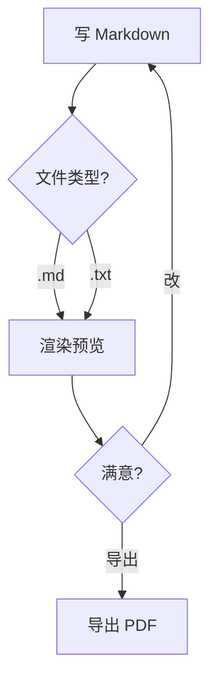
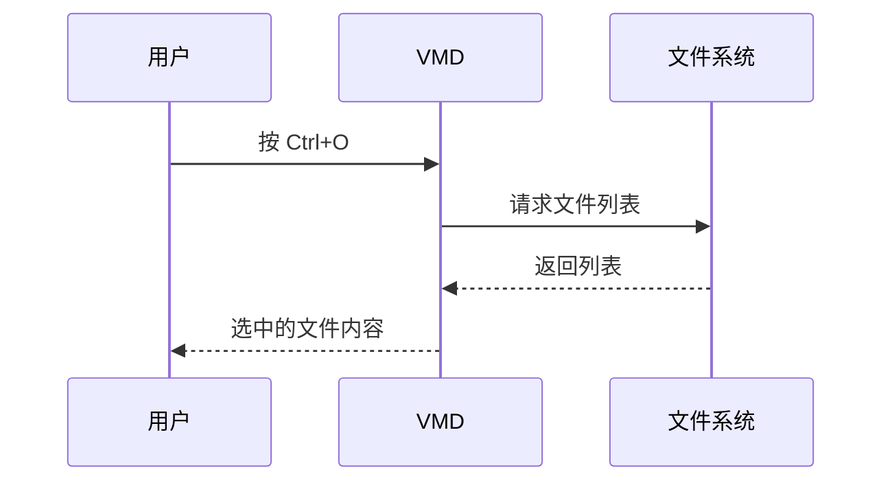

# VMD · 一个轻量的 Markdown 编辑器（带实时预览）

[](https://github.com/oyksoft/VMD)
[](https://github.com/oyksoft/VMD)
[](https://github.com/oyksoft/VMD)

> 用 Tauri + 系统自带 WebView 写的小工具，**打开就能用**，**全离线**，**不需要 Node / Python / Electron**。

左边写，右边实时看到效果。写的每一个字都是**纯 Markdown 源码**，所见即所得，不给你偷偷加格式。

---

## 三种用法，切换着来

- ✏️ **编辑模式** —— 左源码右预览，边写边看（拖分隔条可以调比例）
- 👁️ **阅读模式** —— 只留预览，沉浸阅读
- 📑 **目录栏** —— 自动列出所有标题，点一下就跳过去

**写作时**：

- 写完按 `Ctrl+S` 直接存成 `.md`（`Ctrl+N` 新建 / `Ctrl+O` 打开 / `Ctrl+Shift+S` 另存为）
- 标题栏显示文件名，改动没保存时后面跟个 `●`
- 滚动时预览区**跟着编辑器一起滚**，长文档不用来回找位置
- 写错 `**加粗**`（中间多了空格）会**黄色高亮 + 悬停提示**，不改你的源码也能发现

**预览时**：

- 点目录跳转、回到顶部 / 跳到底部
- 右键菜单：复制 / 全选 / 格式化（加粗、斜体、代码）/ 插入链接、代码块、表格
- 点链接或图片，**在外部浏览器打开**，App 自己不跳走
- 代码块右上角有**语言标签**和**复制按钮**，点一下复制整段代码
- 表格是清爽的网格样式，只有一层淡淡的线

**导出 PDF**：

- 工具栏「导出 PDF」按钮（或 `Ctrl+Shift+E`）
- 用的是**当前渲染引擎直接出图**，所以排版跟你看到的**一模一样**（流程图、公式、高亮全在）
- 自动只导**正文内容**（不含工具栏/目录/编辑区），A4 纵向，自动切浅色打印配色

---

## 它能渲染什么

| 内容 | 支持 | 示例 |
|---|---|---|
| 标准 Markdown（标题 / 列表 / 引用 / 表格 / 引用块） | ✅ | 标准语法 |
| **加粗** *斜体* ~~删除线~~ | ✅ | `**加粗**` `*斜体*` `~~删除线~~` |
| `行内代码` 和多行代码块 | ✅ | 自动语法高亮，右上角有语言标签 + 复制按钮 |
| 图片 + 链接 | ✅ | 点击图片 / 链接在**外部浏览器**打开，App 本身不跳转 |
| 表格 | ✅ | GitHub Flavored Markdown 风格 |
| 任务列表 | ✅ | `- [x] 已完成` `- [ ] 待办` |
| 流程图 / 序列图 / 类图 / 状态图 / 甘特图 / 饼图 | ✅ | 用 Mermaid，写法兼容老式和新式两种 |
| 数学公式 | ✅ | 行内 `$E=mc^2$` / 块级 `$$\int...$$`，支持 LaTeX |
| 代码块直接当公式渲染 | ✅ | `math` / `latex` 代码块当公式 |
| 内联目录 `[TOC]` / `[TOCM]` | ✅ | 自动生成当前位置的目录 |

---

## 它长什么样

**三栏布局** —— 目录 / 编辑区 / 预览区，**每一栏宽度都能拖动**，双击分隔条恢复默认。

- 📑 **左侧**：自动从 Markdown 标题生成目录，点一下跳转
- ✏️ **中间**：Markdown 源码编辑器
- 👀 **右侧**：实时渲染的预览

**四种配色**：
- 🖥️ 跟随系统
- 🌙 暗色
- 🌫️ 灰色
- ☀️ 浅色

---

## 实用功能

### 智能书写提示

写错 `**...**`（中间有空格不形成粗体）时，预览里会**黄色高亮 + 悬停提示**哪里写错了。不污染 Markdown 源码。

### 右键菜单

每个区域有自己的菜单项：

**编辑区**：撤销 / 重做 / 剪切 / 复制 / 粘贴 / 全选 / 加粗 / 斜体 / 代码 / 链接 / 代码块 / 表格

**阅读区**：复制 / 全选 / 回到顶部 / 跳到底部 / 打开链接

### 滚动同步

在编辑区滚轮上下滚，**预览区跟着滚**（反之亦然）。长文档不用手动找对应位置。

### 链接不在应用里跳转

点预览里的链接（包括图片包着链接的情况），**调用系统默认浏览器打开**——Edge / Chrome / Firefox 看你设置。Markdown 应用永远不会"卡在某个网页"。

### 文件操作

- `Ctrl+N` 新建 · `Ctrl+O` 打开 · `Ctrl+S` 保存 · `Ctrl+Shift+S` 另存为
- 支持 `.md` / `.markdown` / `.txt`
- 标题栏显示文件名，`●` 表示有未保存修改

---

## 实际渲染效果

下面这些不是截图，是 **README 本身**。GitHub 原生支持 mermaid 和公式，所以你在网页上看到的就是 VMD 里的效果。

### 流程图



### 序列图



### 数学公式

行内：质能方程 $E = mc^2$，欧拉恒等式 $e^{i\pi} + 1 = 0$。

块级（麦克斯韦方程组）：

$$
\nabla \cdot \mathbf{E} = \frac{\rho}{\varepsilon_0}
\qquad
\nabla \times \mathbf{B} = \mu_0 \mathbf{J} + \mu_0 \varepsilon_0 \frac{\partial \mathbf{E}}{\partial t}
$$

高斯积分：

$$
\int_{-\infty}^{\infty} e^{-x^2}\,dx = \sqrt{\pi}
$$

### 表格 / 任务列表 / 引用

| 功能 | 状态 | 备注 |
|---|:---:|---|
| 表格 | ✅ | 自动对齐、边框自适应主题 |
| 任务列表 | ✅ | `- [x]` / `- [ ]` |
| 引用块 | ✅ | 可嵌套 |

- [x] 打开文件
- [x] 实时预览
- [x] 导出 PDF
- [ ] 云同步（还没做）

> 引用块也支持嵌套。
>
> > 像这样。

### 代码高亮

代码块右上角会显示**语言名**（源码里 ``` 后面写的那种，没写就不显示），旁边有个**复制按钮**，点一下复制整段代码。

```python
def fibonacci(n: int) -> int:
    """斐波那契数列"""
    a, b = 0, 1
    for _ in range(n):
        a, b = b, a + b
    return a
```

### 目录占位符

在 VMD 里写 `[TOC]` 或 `[TOCM]`，会在当前位置插入自动生成的目录（GitHub 不支持这个语法，所以这里只能看源码）：

```markdown
# 标题

[TOC]      ← 层级缩进目录
[TOCM]     ← 扁平列表目录
```


---

## 离线 / 本地化

- **所有依赖打包到本地**（`vendor/` 目录，约 3.3MB）—— KaTeX 数学公式字体、Mermaid 流程图库、highlight.js 代码高亮、Markdown 解析器
- **不联网**（首次启动后无任何网络请求）
- **不收集数据**
- **单文件 3.7MB** —— 所有前端资源经 brotli 压缩后嵌进 exe，绿色版解压即用，不写注册表

---

## 适合谁用

- 写技术文档 / 博客草稿 / README 的人
- 需要**离线**或在内网工作的环境
- 不想装 Electron + VSCode + 各种插件的"重型方案"
- 喜欢 Markdown 但不想被 Typora / Obsidian 等"格式锁死"绑架的人（VMD 写的就是纯 Markdown 源文件，所见即所得，不擅自改你的格式）
- 需要**既读又写**的人（内置编辑器 + 实时预览，拖动分隔条可以左右分屏对照）
- 在 Windows 上

---

## 不适合谁用

- ❌ macOS / Linux 用户（当前 Windows 专属，依赖 WebView2；移植需要小改但还没做）
- ❌ 需要协同 / 云同步的人（VMD 是纯本地工具）
- ❌ 需要导出 Word / PPT / EPUB 的人（当前只支持导出 PDF）
- ❌ 需要"所见即所得"的富文本编辑器的人（VMD 写的是纯 Markdown 源码，不是 Word 那种所见即所得）

---

## 运行 / 开发

```bash
cd src-tauri
cargo run          # 调试（带 CMD 窗口，方便看日志）
cargo build --release   # 发布（约 1 分钟，产物在 target/release/vmd.exe）
```

前端纯 HTML / CSS / JS，**无构建步骤**，改完刷新即可。

### 打包绿色版

```bash
cd src-tauri
touch tauri.conf.json          # ⚠️ 换过图标后必须 touch，否则图标不会重新嵌入
cargo build --release
mkdir -p ../release && cp target/release/vmd.exe ../release/
cd ../release && zip VMD-0.1.1-win64-portable.zip VMD.exe README.txt
```

> `touch tauri.conf.json` 这步别漏 —— `tauri-build` 只监听配置文件的变化，
> 改了 `icons/icon.ico` 不 touch 的话，exe 里还是旧图标。

---

## 更新日志

### 0.1.1（当前）

**新增**

- 📄 **导出 PDF** —— 工具栏按钮 / `Ctrl+Shift+E`，用当前渲染引擎直接出图，流程图、公式、代码高亮全部保留
  - 自动只导正文（不含工具栏/目录/编辑区），A4 纵向
  - 自动切换浅色打印配色，深色背景不再浪费墨
- 📋 **代码块复制按钮** —— 右上角一键复制，点击后图标变成对勾
- 🏷️ **代码块语言标签** —— 源码里 ` ```python ` 指定的语言会显示在右上角（没指定就不显示）
- 🎨 **新应用图标** —— Markdown 官方标志 M↓，7 种尺寸（16→256）适配高分屏
- 🖼️ **表格样式重做** —— 网格线只画一层，不再是叠成双线的"厚边框"
- 🖌️ **等宽字体优化** —— Cascadia Mono / Consolas + 中文用无衬线（不再掉到宋体）
- 📦 **体积从 5.5MB 降到 3.7MB** —— 移除用不上的插件、精简依赖、精简编译参数

**修复**

- 🐛 "跟随系统"主题现在**真的**跟随系统（之前被 Tauri 强制成浅色）
- 🐛 主题按钮默认显示"跟随系统"，tooltip 提示当前实际生效的
- 🐛 导出 PDF 只有第一页有内容（html/body 的 `overflow:hidden` 裁掉了）
- 🐛 Mermaid 图表在暗色/灰色主题下线条看不清（现在跟随主题配色）
- 🐛 `**加粗**` 误报黄色警告（判断条件写反了）
- 🐛 代码块/行内代码里的 `[TOC]` 会被误替换成真目录
- 🐛 多个 `[TOC]` 只有第一个被替换
- 🐛 点目录跳转时工具栏消失
- 🐛 右键菜单点一下就消失 / 关不掉
- 🐛 预览区链接会把整个 App 跳走（现在交给系统浏览器）

### 0.1.0

- 初版：三栏布局、双模式切换、四套主题、代码高亮、文件操作、快捷键

---

## 项目结构

```
VMD/
├── src/                    ← 前端（纯 HTML/CSS/JS，无构建步骤）
│   ├── index.html
│   ├── style.css
│   ├── app.js
│   └── vendor/             ← 本地依赖，不联网
│       ├── marked.min.js           Markdown 解析
│       ├── highlight.min.js        代码高亮
│       ├── highlight-*.css         高亮配色（暗/灰/浅）
│       ├── katex/                  数学公式（含字体）
│       └── mermaid.min.js          流程图 / 序列图
├── src-tauri/              ← Rust 后端（Tauri 2）
│   ├── Cargo.toml
│   ├── tauri.conf.json
│   ├── capabilities/       权限白名单
│   ├── icons/              应用图标（含 icon.svg 源文件）
│   └── src/main.rs
└── release/                ← 绿色版产物（VMD.exe + zip）
```

---

## 许可

MIT（暂定 — 可改）