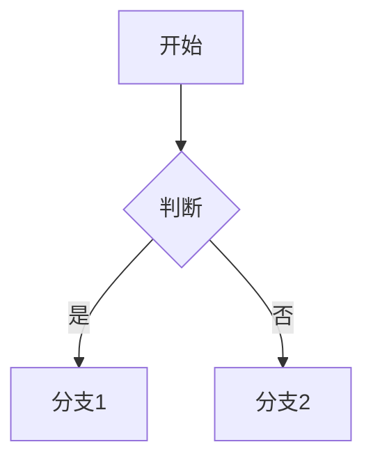

# VMD · 一个轻量的 Markdown 阅读 / 编辑工具

> 用 Tauri + 系统自带 WebView 写的小工具，**打开就能用**，**全离线**，**不需要 Node / Python / Electron**。

---

## 它能渲染什么

| 内容 | 支持 | 示例 |
|---|---|---|
| 标准 Markdown（标题 / 列表 / 引用 / 表格 / 引用块） | ✅ | 标准语法 |
| **加粗** *斜体* ~~删除线~~ | ✅ | `**加粗**` `*斜体*` `~~删除线~~` |
| `行内代码` 和 ```多行代码``` | ✅ | 自动语法高亮 |
| 图片 + 链接 | ✅ | 点击图片 / 链接在**外部浏览器**打开，App 本身不跳转 |
| 表格 | ✅ | GitHub Flavored Markdown 风格 |
| 任务列表 | ✅ | `- [x] 已完成` `- [ ] 待办` |
| 流程图 / 序列图 / 类图 / 状态图 / 甘特图 / 饼图 | ✅ | 用 Mermaid，写法兼容老式和新式两种 |
| 数学公式 | ✅ | 行内 `$E=mc^2$` / 块级 `$$\int...$$`，支持 LaTeX |
| 代码块直接当公式渲染 | ✅ | ` ```math ` ` ```latex ` 代码块当公式 |
| 内联目录 `[TOC]` / `[TOCM]` | ✅ | 自动生成当前位置的目录 |

---

## 它长什么样

**三栏布局** —— 目录 / 编辑区 / 预览区，**每一栏宽度都能拖动**，双击分隔条恢复默认。

- 📑 **左侧**：自动从 Markdown 标题生成目录，点一下跳转
- ✏️ **中间**：Markdown 源码编辑器
- 👀 **右侧**：实时渲染的预览

**两种模式**一键切换：
- 👁️ **阅读模式**：只看预览（编辑时不被打扰）
- ✏️ **编辑模式**：左右都显示，所见即所得

**四种配色**：
- 🖥️ 跟随系统
- 🌙 暗色
- 🌫️ 灰色
- ☀️ 浅色

---

## 实用功能

### 智能书写提示

写错 `**...**`（中间有空格不形成粗体）时，预览里会**黄色高亮 + 悬停提示**哪里写错了。不污染 Markdown 源码。

### 右键菜单

每个区域有自己的菜单项：

**编辑区**：撤销 / 重做 / 剪切 / 复制 / 粘贴 / 全选 / 加粗 / 斜体 / 代码 / 链接 / 代码块 / 表格

**阅读区**：复制 / 全选 / 回到顶部 / 跳到底部 / 打开链接

### 滚动同步

在编辑区滚轮上下滚，**预览区跟着滚**（反之亦然）。长文档不用手动找对应位置。

### 链接不在应用里跳转

点预览里的链接（包括图片包着链接的情况），**调用系统默认浏览器打开**——Edge / Chrome / Firefox 看你设置。Markdown 应用永远不会"卡在某个网页"。

### 文件操作

- `Ctrl+N` 新建 · `Ctrl+O` 打开 · `Ctrl+S` 保存 · `Ctrl+Shift+S` 另存为
- 支持 `.md` / `.markdown` / `.txt`
- 标题栏显示文件名，`●` 表示有未保存修改

---

## 用起来的样子

```markdown
# 一份文档

## 数学公式
爱因斯坦场方程：
$$G_{\mu\nu} + \Lambda g_{\mu\nu} = \frac{8\pi G}{c^4} T_{\mu\nu}$$

## 流程图


## 老式 flowchart 也支持
```seq
st=>start: 用户登陆
op=>operation: 登陆操作
cond=>condition: 成功?
e=>end: 进入后台
st->op->cond
cond(yes)->e
cond(no)->op
```

## 目录占位符
[TOC]   ← 自动生成上面所有标题的目录
```

---

## 离线 / 本地化

- **所有依赖打包到本地**（`vendor/` 目录，约 3.5MB）—— KaTeX 数学公式字体、Mermaid 流程图库、highlight.js 代码高亮、Markdown 解析器
- **不联网**（首次启动后无任何网络请求）
- **不收集数据**

---

## 适合谁用

- 写技术文档 / 博客草稿 / README 的人
- 需要**离线**或在内网工作的环境
- 不想装 Electron + VSCode + 各种插件的"重型方案"
- 喜欢 Markdown 但不想被 Typora / Obsidian 等的"格式锁死"绑架（VMD 只渲染，**不**修改你的 `.md` 源文件）
- 在 Windows 上

---

## 不适合谁用

- ❌ macOS / Linux 用户（当前 Windows 专属，依赖 WebView2；移植需要小改但还没做）
- ❌ 需要协同 / 云同步的人（VMD 是纯本地工具）
- ❌ 需要导出 PDF / Word 的人（当前只支持 Markdown 渲染）

---

## 运行 / 开发

```bash
cd src-tauri
cargo run
```

首次编译约 1 分钟，之后增量 ~2 秒。

前端纯 HTML / CSS / JS，无构建步骤。

---

## 许可

MIT（暂定 — 可改）