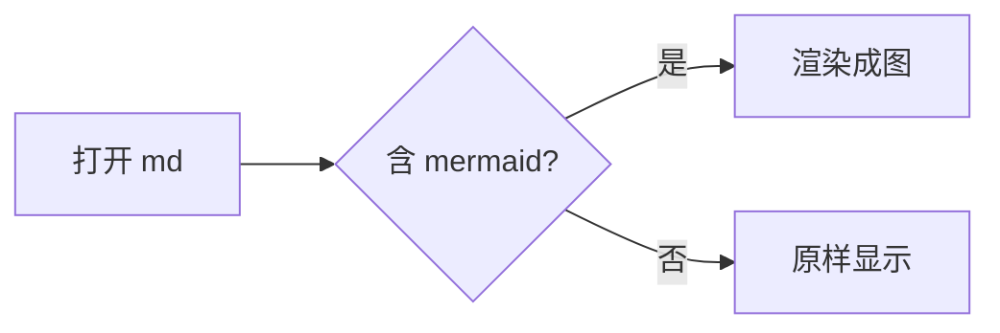

# Mermaid / KaTeX 安全设置自检

`securityLevel` 从 `loose` 收紧到 `strict` 之后的回归样例。

## 1. 正常图 —— 应该正常渲染



## 2. click 链接 —— strict 下**不该**出现可点链接


预期：图正常显示，但「起点」不是超链接（点击无跳转）。

## 3. 节点里的 `<br>` —— strict 下会显示成字面量


预期：看到的是 `第一行<br>第二行`（**行为变更**，以前会真的换行）。
如果确实需要换行，改用 `\n` 或拆成两个节点。

## 4. 语法错误 + 恶意源码 —— 应显示红框错误块，**不弹窗**

```mermaid
flowchart
  A --> 
```

## 5. 公式错误 + 恶意源码 —— 同样**不弹窗**

```latex
\frac{  "}{2}
```

预期：两块都显示「渲染失败」的红框，框里能看到原始源码（说明走的是 `textContent`）。
**只要弹了 alert，就说明错误提示块又被拼回 `innerHTML` 了。**
