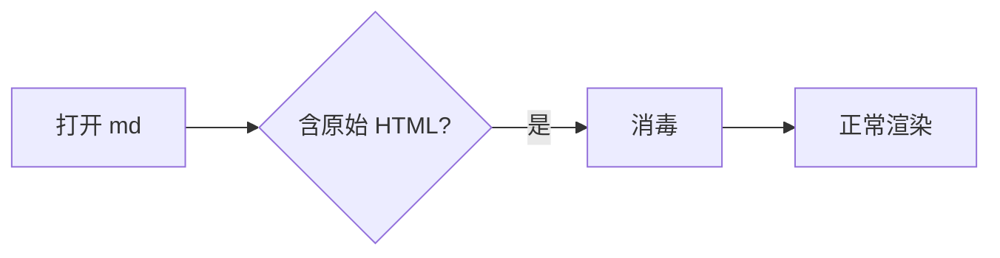

# 消毒自检样例

把这份文件拖进 VMD（或 Ctrl+O 打开），逐条对照下面的预期。

## 1. 事件属性（预期：只显示一张破图，**不弹窗**）


## 2. SVG onload（预期：一个空圆圈或什么都没有，**不弹窗**）

<svg onload="alert('XSS: svg onload 执行了')" width="40" height="40">
  <circle cx="20" cy="20" r="15" fill="currentColor"/>
</svg>

## 3. script 标签（预期：**什么都不显示**，也不弹窗）

<script>alert('XSS: script 执行了')</script>

## 4. javascript 链接（预期：显示「点我试试」但点了**没反应**）

[点我试试](javascript:alert('XSS: javascript 链接执行了'))

## 5. file 链接（预期：显示「算一下 2+2」但点了**不会启动计算器**）

[算一下 2+2](file:///C:/Windows/System32/calc.exe)

## 6. style 标签（预期：这一段**不会**让整页变黑，因为标签被删了）

<style>body { background: #000 !important; color: #000 !important; }</style>

这一段应该正常可见。

## 7. 以下功能必须**照旧正常**

行内数学：$E = mc^2$



```python
def fib(n):
    a, b = 0, 1
    for _ in range(n):
        a, b = b, a + b
    return a
```

| 功能 | 预期 |
|---|---|
| 表格 | 正常 |
| 任务列表 | 正常（复选框保留） |

- [x] 已勾选
- [ ] 未勾选

**加粗** *斜体* ~~删除线~~ `行内代码` :smile:

- 相对路径图片（应显示破图但 src 保留）


